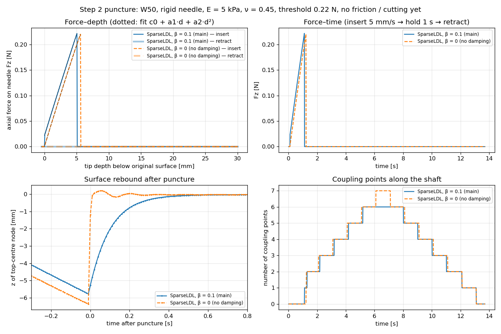

# 第 2 步：刺穿机制（结果和决策记录）

- 日期：2026-10-12 – 10-13。工作方式按 2026-10-09 的轻量验证：实现 → 演示场景（用户 GUI 目测）→ 一条力–深度曲线和 Okamura 2004 定性对比 → 基本合理性检查 → 总结。
- 脚本：`scenes/step2/`；结果：`results/step2/`。复现命令见 §6。

## 1. 机制（插件原生，没有新写 C++）
用 CollisionAlgorithm / ConstraintGeometry v25.12 的 `InsertionAlgorithm` 状态机（逐行分析见 `docs/code/01_needle_plugins_v25.12.md`）：

1. **刺穿前**：针尖（单点 `PointGeometry`）和组织表面之间是单边约束（`ConstraintUnilateral` + `SecondDirection`），即第 1 步的 tenting。
2. **刺穿判据**：上一步针尖 MO 上的 Σ‖λ‖/dt 超过 `punctureForceThreshold` 时刺穿（一步延迟）〔代码，`InsertionAlgorithm.cpp:177-197`〕。单点针尖只有 1 行法向约束，所以判据量就是针尖法向力。
3. **刺穿后**：针尖下的表面点成为第一个耦合点，针尖接触撤掉。之后针尖每超过最后一个耦合点 `tipDistThreshold` = 5 mm，就在"最后一个耦合点 + 5 mm（沿针身）"处取一个候选点，**只接受落在组织四面体内的候选点**（重心坐标在闭区间 [0, 1] 内，点落在节点 / 棱 / 面上也接受）。
4. **耦合点**：组织一侧的点（重心坐标）是持久的；每步重新投影到针身上，重建约束行。`ConstraintInsertion` + `FirstDirection` 给每个耦合点 3 行：2 行横向（组织点必须在针轴上）+ 1 行轴向。本步 `frictionCoeff = 0`：轴向行的力恒为 0，组织沿针自由滑动（它不是物理摩擦系数，见 `docs/code/01` 问题 1）。摩擦是第 4 步、切割是第 5 步。
5. **后退**：针尖退过的耦合点逐个删除，全部删除后回到刺穿前状态（插件不记住针道，再次插入要重新刺穿）。
6. 耦合点间距 5 mm ≥ 局部单元尺寸：间距远小于单元尺寸会过约束、GS 不收敛（`docs/code/04` 实验 9，Martin 2023 表 2）。Adagolodjo 2019、Baksic 2022 也用类似间距。

实现：`scenes/contact.py` 的 `add_puncture_insertion`（组件组合同官方场景 `NeedleInsertion.py:185-201`，针身碰撞关闭）。

## 2. 验证算例
- W50（1242 节点），FTCfix polar，E = 5 kPa，ν = 0.45（验证用参数），底面固定，无重力；刚性纯运动学针，竖直对准顶面中心，单点针尖。
- 轨迹：表面上方 0.5 mm 出发，5 mm/s 下插到 30 mm 深，停 1 s，再以 5 mm/s 退回出发点，停 0.5 s（共 13.7 s）。
- 刺穿阈值 0.22 N：**只用于验证**，让刺穿发生在约 5 mm 压深（W50 单点针尖的可压深度约 8 mm，第 1.5 步）。真实阈值（Okamura 牛肝约 2.3 N）留到参数标定阶段。
- **组织阻尼 β = 0.1 s**（Rayleigh 刚度阻尼 C = βK，α = 0），原因见 §3。
- 离线验证用 SparseLDLSolver（R1，确定性）；GUI 用 AsyncSparseLDLSolver（R3）。

## 3. 组织阻尼：为什么加、加了什么、影响多大（用户 2026-10-13 决定）

### 3.1 问题：不加阻尼时，实时求解器在刺穿回弹时发散
- 离线求解器（R1）不加阻尼时完全正常：刺穿后被压下约 6.4 mm 的表面在 2–3 步（20–30 ms）内弹回，之后约 0.2 mm 的小振荡逐渐衰减。
- 实时求解器（R3，`AsyncSparseLDLSolver`）同样的场景，刺穿后几步内发散〔运行，`s2_damping_checks.py` 算例 ①〕。关掉插入（只有刺穿 + 回弹）也一样发散，所以问题出在回弹本身。
- 原因：R3 用后台线程算好的旧分解求解。SOFA 文档写明"分解至少落后一个时间步……可能引入不稳定"。W50 上分解一次约 85 ms（同步 SparseLDL 每步约 92 ms，异步约 6 ms〔运行〕），所以实际用的是**大约 8–9 步之前的矩阵**。回弹时被压缩得最厉害的单元（体积比约 0.5）一两步内恢复，刚度矩阵每步变化很大，旧矩阵的解偏差很大，误差逐步放大。

### 3.2 考虑过的办法
| 办法 | 结果 |
|---|---|
| 降低阈值（0.10 N，约 2.5 mm 压深刺穿） | 稳定（2/2 次），但只是避开问题，改变了验证条件 |
| 回弹期间临时切到同步分解（`linsolver.reset()`） | 没有触发同步分解，无效 |
| PCG + 异步分解作预条件器（Courtecuisse 团队的做法：自由运动每次迭代用当前矩阵，结果正确；约束部分 W 仍用旧分解） | 试了 3 种配置（v25.12 需要 `PreconditionedMatrixFreeSystem`），都仍发散，且无法确认 PCG 真的在迭代。估计还要 1–3 天、可能走不通 → **记为以后的可选改进** |
| 同步 SparseLDL 加速 | METIS 排序：每步 92 → 约 66 ms（约 15 帧/秒）；Eigen LDLᵀ 同样水平；`parallelInverseProduct`、`wire_optimization` 无效果；COLAMD / 不排序慢 10–20 倍。要到 30 帧/秒需要多线程超节点分解库（CHOLMOD 等，SOFA 包里没有，要自己接），未做 |
| **组织 Rayleigh 刚度阻尼 β = 0.1** | 采用（下面） |

### 3.3 采用：组织黏性 β = 0.1 s（文献值，未标定）
- 依据：针插入仿真的组织模型普遍带 Rayleigh 阻尼——Duriez 2009（"viscous behavior is obtained using Rayleigh model"，笔记 01）；**Bui 2019：C = αM + βK，α = 0.01，β = 0.1**，理由是"缺少黏性参数的数据，难以确定阻尼矩阵"（原文 p.187–188，笔记 11）；Baksic 2022（笔记 20）。β 直接取 Bui 2019 的值，没有经过标定。
- **如实说明**：这些文献并不是用阻尼来解决求解器不稳定；我们是因为 R3 发散才加的阻尼。
- 加了阻尼以后，R3 算得对吗？对照检查（§3.4）：R3 + β 和 R1 + β 的结果几乎一样，所以阻尼不是"答案仍然错、只把振荡压住"，而是**改变了组织的物理行为**（回弹从约 20 ms 变成约 0.1 s 回弹一半、0.5 s 基本回平），在这个行为下旧分解够用。
- 物理含义：β 阻碍的是变形速度（组织内部黏性）。最低振动模态约 ω ≈ 30 rad/s〔推导，粗估〕，阻尼比 ζ = βω/2 ≈ 1.5 → 组织整体是过阻尼的，回弹不振荡。真实软组织是黏弹性的，瞬间弹回（20 ms）并不更真实，而且 dt = 0.01 也分辨不了那么快的过程；但 β = 0.1 的回弹速度没有实验依据。
- **α 不加**：α 阻碍的是绝对速度（类似环境拖曳），组织底面固定、没有周围介质，没有明确物理依据；α = 0.01（Bui 2019）的阻尼比约 0.0002，实测影响 < 1e-6 N（§3.4 算例 ③）。
- **对力的影响**（§4 的拟合）：阻尼几乎不改变弹性部分（刺穿前斜率 0.041 vs 0.042 N/mm），而是在针一碰到组织时加了一个约 **0.021 N 的黏性力台阶**（≈ β·k·v = 0.1 s × 0.042 N/mm × 5 mm/s），4 mm 压深处约大 13%，刺穿提前到 5.10 mm（不加阻尼 5.65 mm）。黏性力和针速成正比，针速越快差别越大。
- 离线验证和 GUI 用**同一个模型**（β = 0.1）。

### 3.4 对照检查（`s2_damping_checks.py`，`results/step2/s2_damping_checks.log`）
轨迹和场景同 §2，只换求解器 / 阻尼；和主结果（R1 + β = 0.1）逐步比较。

| 算例 | 结果 |
|---|---|
| ① R3，不加阻尼 | 刺穿（第 123 步，5.65 mm）后第 8 步（第 131 步）发散 |
| ② R3 + β = 0.1 | 全程稳定。和 R1 + β = 0.1 比：轴向力最大差 4e-5 N，顶面节点 z 最大差 0.017 mm，耦合点数逐步相同（这次运行；前一次临时测试为 3e-3 N、0.015 mm，R3 每次运行略有不同） |
| ③ R1 + β = 0.1 + α = 0.01 | 和主结果比：轴向力最大差 2.7e-7 N，位移差 < 0.001 mm → α 可忽略 |

## 4. 结果（R1，dt = 0.01，β = 0.1；`s2_puncture.py`，`results/step2/s2_puncture_dt0.01.{npz,log}`）



| 检查 | 结果 |
|---|---|
| 刺穿时刻 | 第 112 步，压深 **5.10 mm**；判据读的那一步针尖力 0.2216 N（一步延迟，比阈值多一步的增量） |
| dt 无关性 | dt = 0.005：5.03 mm（相差 0.07 mm，约 1.4 个 dt = 0.01 步的位移内） |
| 刺穿后轴向力 | 恒为 0（frictionCoeff = 0、无切割，符合预期） |
| 回弹 | 顶面中心节点 −5.77 mm → 刺穿后 3 / 10 / 50 步 −3.98 / −2.03 / −0.07 mm，不振荡 |
| 耦合点 | 0.02、5.41、10.41、15.41、20.41、25.41 mm（插到 30 mm 时 6 个） |
| 后退 | 耦合点在针尖经过时逐个删除（25.4、20.4、…、5.0 mm），针尖回到表面时全部删除，回到刺穿前状态；之后针上无力 |
| 作用力 = 反作用力 | max \|F_针 + F_组织\| = 5.6e-17 N |
| GS | 迭代次数中位数 23、最大 40，最大 18 行，误差 ≤ 1.6e-11 |
| 侧向力 | 刺穿后最大 0.015 N（约为刺穿前峰值的 7%；网格不对称，第 1.5 步已知局限） |
| 单元质量 | 最差体积比 0.55（没有翻转） |

- 第 2 个耦合点在 5.41 mm 而不是 5.0 mm（不加阻尼时是 5.0 mm）：第 2 个点是"第 1 个点 + 5 mm"，加阻尼后第 1 个点（表面点）回弹得慢，取第 2 个点时它还在表面以下约 0.4 mm。之后的点都以它为基准。这只是耦合点的取样位置，在无摩擦时不影响力。
- 不加阻尼的 R1 对照（`s2_puncture_dt0.01_beta0.*`）：刺穿 5.65 mm，耦合点 0.02、5.0、…、30.0 mm（7 个），其余结论相同。

### 4.1 和 Okamura 2004 的定性对比（笔记 05）
| | Okamura 2004（牛肝离体，3 mm/s） | 本模型（验证参数） |
|---|---|---|
| 刺穿前 | 力随深度二次上升 f = a₁z + a₂z²；肝脏 1：a₁ = 0.048 N/mm，a₂ = 0.0052 N/mm² | 拟合 F = 0.021 + 0.041·d − 0.0003·d²（N, mm），几乎线性；**a₁ 和肝脏 1 同一量级** |
| 刺穿 | 峰值 2.30 ± 0.83 N，深度 16.7 ± 3.6 mm，之后骤降约 0.66 N | 峰值 0.22 N（人为验证阈值）、5.1 mm，之后**降到 0** |
| 刺穿后 | 摩擦 + 切割，力缓慢上升（50 mm 时约 1 N） | 0（还没有摩擦 / 切割） |
| 停止时 | 指数松弛（黏弹性） | 0 |
| 拔出 | 力反向（约 −1 N） | 0 |

- 一致的地方：刺穿前的上升 → 刺穿时力骤降，这个形状是对的；刺穿前斜率的量级和牛肝相当。
- 差别和原因：
  - 刺穿后力为 0：摩擦（第 4 步）和切割（第 5 步）还没加，**符合本步预期**；
  - 刺穿前接近线性而不是二次增硬：共旋线弹性材料没有应变增硬，单点针尖下局部单元还会变软；
  - 刺穿深度和峰值远小于实验：阈值是人为设的验证值，单点针尖在 W50 上约 8 mm 就会压坏单元（第 1.5 步）；
  - 加阻尼后有一个黏性台阶（0.021 N）；Okamura 曲线的起点被测量噪声和表面接触掩盖，看不出有没有。

## 5. 已知局限
1. **β = 0.1 是未标定的文献值**，加入它的直接原因是 R3 在刺穿回弹时发散；它使 5 mm/s 下刺穿前的力约大 0.021 N（4 mm 处 +13%），刺穿提前约 0.5 mm。定量阶段要么标定组织黏性，要么换掉 R3 的求解方式（PCG + 异步预条件器，§3.2）后重新评估。
2. 刺穿阈值 0.22 N 是验证用值；判据有一步延迟（dt = 0.01 时约 0.05 mm）。
3. 插件后退到表面就忘记针道；再次插入要重新刺穿（真实组织里针道会保留）。
4. 侧向力：刺穿后最大约 0.015 N，来自网格不对称（第 1.5 步已知局限，第 8 步之前必须检查）。
5. 针尖方向约束（Duriez 2009 的针尖切割方向）还没有，刚性针沿固定轨迹运动时不需要；第 8 步柔性针时要考虑。
6. GUI 的 R3 结果和 R1 有约 2–3% 的小差别（第 0 步已知），且每次运行略有不同。

## 6. 复现
```bash
cd scenes/step2
python3 s2_puncture.py 0.01        # 主结果（R1，β = 0.1）→ results/step2/s2_puncture_dt0.01.{npz,log}
python3 s2_puncture.py 0.005       # dt 对照
python3 s2_puncture.py 0.01 0      # 不加阻尼的对照 → s2_puncture_dt0.01_beta0.*
python3 s2_damping_checks.py       # §3.4 对照检查（需要先跑主结果）
python3 s2_plot.py                 # §4 的图 → results/step2/s2_force_depth.png
# GUI（项目目录下，用户在自己的屏幕上运行）：
RUNSOFA_OPTS="-g glfw" tools/run_gui.sh scenes/step2/s2_gui_scene.py [A|C|orig]
# 远程时录屏（解锁 → 录制 → 锁回，见 CLAUDE.md）：
tools/remote_capture.sh video results/step2/s2_gui_A.mp4 45 "回到刺穿前状态" scenes/step2/s2_gui_scene.py A
```
（终端输出用 `| grep -v '^\['` 去掉 SOFA 日志后存为 `.log`。）

## 7. GUI 检查
- 2026-10-13，方案 A（R3 + β = 0.1）。用户在 Mac 上远程，所以在游戏本屏幕上运行并录屏（`tools/remote_capture.sh`）：`results/step2/s2_gui_A.mp4`（1280×960，30 帧/秒，24.5 s），终端输出 `s2_gui_A.log`，视角预览 `s2_gui_A_preview.png`（第 100 / 120 / 420 步）。
- 相机：斜前上方（偏 25°、仰角 20°、距离 17 cm），组织半透明，只显示外观模型和插件画的耦合点（`s2_gui_scene.py` 的 `add_camera`）。
- 看到的现象：针尖下的漏斗形凹坑 → 第 112 步（5.10 mm）刺穿，凹坑平滑弹平、没有抖动 → 沿针道每 5 mm 出现一个耦合点 → 退回时逐个消失，第 1310 步全部删除，表面恢复平整。和离线结果一致。
- 流畅度：54–60 帧/秒，每步计算中位数 13–15 ms，超过 33 ms 的帧 0.1%。
- **用户确认视频没有问题（2026-10-13）。**
