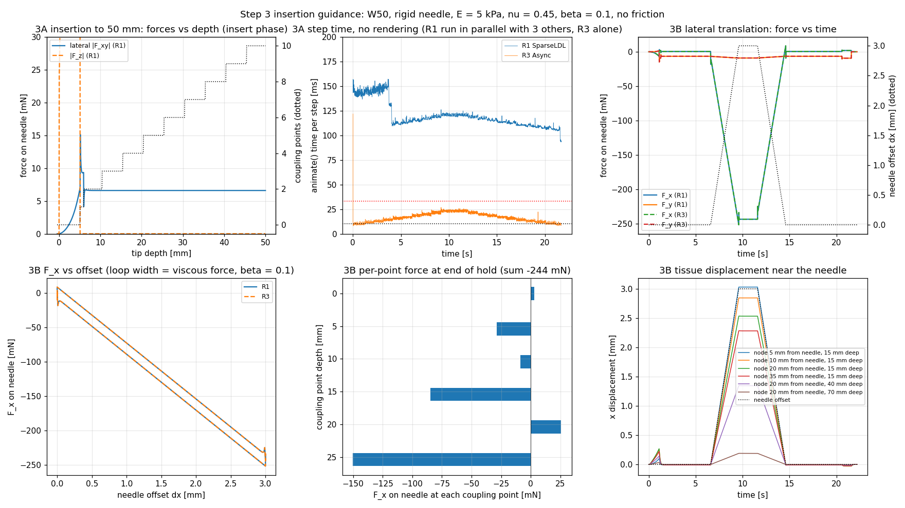
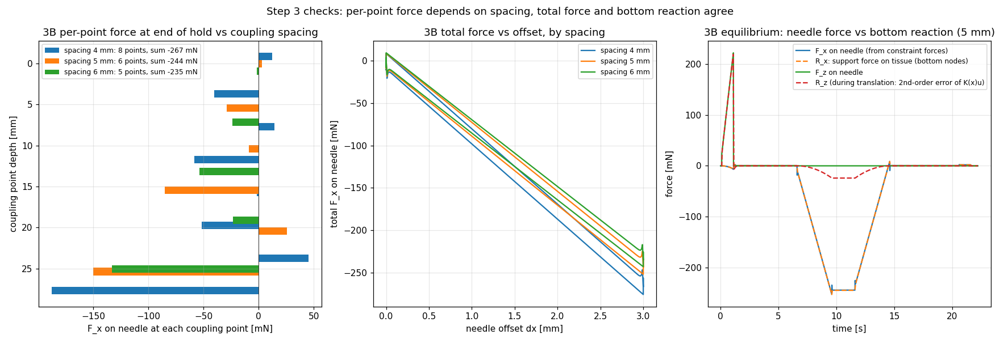

# 第 3 步：插入导向（横向约束，不加摩擦）—— 结果和决策记录

- 日期：2026-10-13。轻量验证：演示场景（录屏）+ 曲线 + 基本合理性检查 + R3 / R1 对照（用户同意的方案）。
- 脚本：`scenes/step3/`；结果：`results/step3/`；复现见 §6。

## 1. 机制（和第 2 步相同，插件原生，没有新代码）
刺穿后 `InsertionAlgorithm` 沿针道每 5 mm 取一个耦合点。每个耦合点是一对点：
- **P**：组织里的物质点，位于某个四面体内部，用重心坐标表示，跟着组织运动；
- **Q**：针中心线上离 P 最近的点，每步重新投影。

`ConstraintInsertion` 给每对点 3 行约束：
- 2 行横向双边约束：P 必须在针轴上，力可推可拉；
- 1 行轴向约束：frictionCoeff = 0，力恒为 0，组织沿针自由滑动。

约束力把 P 拉回针轴：组织受 +λ，针受 −λ（按重心坐标 / 线段权重分到节点上）。详细说明见 `docs/code/01_needle_plugins_v25.12.md` §1；和重划网格路线（Chentanez 2009）的比较见笔记 09。

第 2 步里这些机制已经在竖直插入到 30 mm 时用上了。但竖直插入时组织本来就在针轴上，横向约束几乎不出力（约 0.01 N），所以第 3 步补两项：插到完整深度（3A），以及一个让横向约束真正出力的检验（3B）。

## 2. 算例
场景和第 2 步完全相同（`s2_puncture.build`）：
- W50，FTCfix polar，E = 5 kPa，ν = 0.45；
- β = 0.1；阈值 0.22 N；
- 刚性纯运动学针，长 100 mm，11 个节点。

只换轨迹（`s3_insertion.trajectories`；`build` 新增参数 `xf`，用于整根针的横向平移）：
- **3A deep**：5 mm/s 插到 50 mm（W50 加密区末端，离固定底面 30 mm），停 1 s，退回。
- **3B lateral**：5 mm/s 插到 30 mm（6 个耦合点），停 0.5 s，整根针以 1 mm/s 沿 +x 平移 3 mm，停 2 s，平移回原位，停 1 s，退回。针是刚性的，刺入点也一起平移。

两个算例都用 R1（离线，结论）和 R3（实时，对照 / 计时）各跑一次。

## 3. 结果



### 3A：插到 50 mm（`s3_deep_ldl.log`）
| 检查 | 结果 |
|---|---|
| 耦合点 | 每 5 mm 一个：0、5.4、10.4、…、45.4 mm，50 mm 时 10 个；加密区末端附近也正常。后退时逐个删除，回到表面时全部删除 |
| P 到针轴的距离 | ≤ 5e-9 mm（组织点始终在针上） |
| 轴向力 | 刺穿后恒为 0 |
| **侧向力随深度** | 刺穿后**恒为约 6.6 mN**，不随深度和耦合点数增加 → 来自刺穿前凹陷留下的不对称（网格不对称），不是插入本身产生的 |
| 作用力 = 反作用力；GS | 5.6e-17 N；迭代次数中位数 28、最大 111，误差 ≤ 3e-11 |
| 单元质量 | 最差体积比 0.55（来自刺穿前的压凹），插入过程中没有变差 |
| R3 每步计算时间（单独运行，不含绘制） | 中位数 16.5 ms，p95 23.8 ms，最大 26.8 ms（10 个耦合点、30 行时），低于 33 ms |

### 3B：横向平移 3 mm（`s3_lateral_ldl.log`）
| 检查 | 结果 | 判断 |
|---|---|---|
| 组织跟着针走 | P 到针轴的距离 < 3e-9 mm；6 个耦合点处的组织都平移 3 mm | 横向约束起作用 ✅ |
| 力的方向 | 针受 −x 方向的力（组织往回拉针） | ✅ |
| 力–位移 | 平移 1 / 2 / 3 mm 时 F_x = −89 / −170 / −244 mN。平移时多约 8 mN 的黏性力（平移结束到保持阶段，−252 → −244 mN；≈ β·k·v = 0.1 s × 81 mN/mm × 1 mm/s）。扣除后，三个位置的刚度都是 **81 mN/mm**，完全线性 | ✅ |
| 可逆 | 回到原位时力约 +9 mN（反向平移的黏性力），随后衰减到约 0；图中力–位移曲线是一个窄环，宽度就是黏性力 | ✅ |
| 量级 | 244 mN，在事先粗估的 0.1–0.7 N 内（每点约 0.04 N/mm × 6 点 × 3 mm 是上限） | ✅ |
| 轴向力；作用力 = 反作用力；GS；单元质量 | 0；8e-17 N；最多 81 次迭代；最差 0.55 | ✅ |
| y 方向的力 | 约 −9 mN（F_x 的 3.7%），网格不对称（第 1.5 步已知局限） | 已知 |
| **R3 对照 R1** | 力相差约 0.1 mN（0.05%），各耦合点的力和组织位移相同（`s3_lateral_async.log`） | ✅ |

**组织位移的分布**（保持阶段，节点 x 位移，mm）：

| | 离针 5 mm | 10 mm | 20 mm | 35 mm（靠近侧面） |
|---|---|---|---|---|
| 15 mm 深 | 3.03 | 2.84 | 2.53 | 2.28 |
| 40 mm 深 | | | 1.35 | |
| 70 mm 深 | | | 0.19 | |

- 横向衰减很少，主要沿深度衰减：组织块上半部分几乎整体被推歪（剪切）。
- 原因：测试块只有底面固定，侧面自由，针推上半部分时整块组织剪切变形。这是边界条件的结果，不是耦合机制的问题。真实组织被周围组织包着，变形会更局部化。
- 15 mm 深、离针 5 mm 处位移 3.03 mm（略大于 3 mm）：整块组织有一点转动（上部偏得多）。

**更大的平移幅度**（用户觉得 3 mm 在视频里不明显，2026-10-13；R3 离线检查，`s3_lateral_async_amp6.log`、`_amp10.log`）：

| 幅度 | 保持结束 F_x | F_x / dx（扣除黏性前 → 保持结束） | 最差单元体积比 | 15 mm 深节点位移（离针 5 / 20 / 35 mm） |
|---|---|---|---|---|
| 3 mm | −244 mN | 89 → 81 mN/mm | 0.55 | 3.03 / 2.53 / 2.28 mm |
| 6 mm | −488 mN | 85 → 81 mN/mm | 0.55 | 6.07 / 5.06 / 4.55 mm |
| 10 mm | −816 mN | 84 → 82 mN/mm | 0.55 | 10.12 / 8.42 / 7.54 mm |

- 到 10 mm 时仍然线性（共旋材料能处理整块转动），单元没有变坏。最差体积比 0.55 来自刺穿前的压凹，平移没有让它变差。
- 各点力的分布形状不变，只是等比例放大。
- 所以演示视频用 10 mm（§4），验证结论仍以 3 mm 的 R1 结果为准。

**各耦合点上的力**（保持阶段，F_x，mN）：

| 深度（mm） | 0 | 5.4 | 10.4 | 15.4 | 20.4 | 25.4 |
|---|---|---|---|---|---|---|
| F_x（mN） | +3 | −29 | −9 | −85 | +26 | −150 |

- 各点之和 = 合力 −244 mN。
- 最深的点受力最大：离固定底面最近，组织最硬，合理。
- 中间正负交替：力集中在离散点上造成的网格效应，**单点的局部力不可靠，合力和整体运动可靠**（约束法的已知局限，见 §5；下面两项检查是证据）。

### 检查 1：耦合点间距 4 / 5 / 6 mm（单点力 vs 合力，用户 2026-10-13 要求）
只改 `tipDistThreshold`，3B 用 R1 各跑一次（`s3_lateral_ldl[_tip4|_tip6].log`）。图：`results/step3/s3_spacing.png`。



| 间距 | 耦合点（深度 mm） | 保持结束各点 F_x（mN） | 合力 F_x | 最深点 | GS 迭代中位数 |
|---|---|---|---|---|---|
| 4 mm | 8 个：0、4.6、8.6、…、28.6 | +12、−40、+14、−58、−1、−51、+45、−188 | −267 mN（+9.5%） | 28.6 mm | 364（最多 610） |
| 5 mm | 6 个：0、5.4、…、25.4 | +3、−29、−9、−85、+26、−150 | −244 mN | 25.4 mm | 40 |
| 6 mm | 5 个：0、6.2、…、24.1 | −2、−24、−54、−23、−133 | −235 mN（−3.5%） | 24.1 mm | 19 |

- **单点力**：分布完全不同。比如约 12 mm 深的点：4 / 6 mm 时约 −55 mN，5 mm 时（10.4 mm 深）只有 −9 mN。正值出现的位置也变了，6 mm 时没有明显的正值。→ 单点力取决于点落在哪个单元、离邻点多远，**没有物理意义**。
- **合力**：在 −235 到 −267 mN 之间，相差约 ±10%；三种间距下都线性、可逆。合力的差别主要来自**最深耦合点的位置**（24.1 / 25.4 / 28.6 mm）：耦合点只到最深那一点，最深点到针尖之间（最多一个间距）的针身不传力。这一段越长，被"拴住"的组织越少，合力越小。这也是离散化误差，但比单点力小得多，而且有明确的原因。
- **整体运动**：15 mm 深、离针 5 mm 处节点位移 2.97 / 3.03 / 2.92 mm；离针 20 mm、40 mm 深处 1.47 / 1.35 / 1.30 mm。差别也在 10% 以内。
- **附带验证了过约束规则**：4 mm 小于针道附近单元尺寸（约 5 mm），GS 迭代次数比 5 mm 时多约 9 倍（中位数 364 对 40），这是开始过约束的信号；6 mm 时只要 19 次。结果仍然收敛（误差 ≤ 2.4e-11）。

### 检查 2：底面反力 = 针上的力（受力平衡，用户 2026-10-13 要求）
针上的力 F 是直接由约束力算的（`common.needle_wrench`：f = Jᵀλ / dt），没有用到底面。这里另外从组织内部算底面固定节点受的力，看两者是否相等。
- **方法**：每 5 步用组织力场自己组装的矩阵（`assembleKMatrix`，SOFA 约定返回 df/dx = −K）估计内力 f = (df/dx)·(x − X0) + β·(df/dx)·v，固定节点上内力之和取负，就是支座作用在组织上的力 R。静止时组织受力平衡：−F（针推组织）+ R = 0，所以 R 应等于 F。
- **结果**（5 mm 间距，`s3_lateral_ldl.log`；图 `s3_spacing.png` 右）：
  - 保持结束：R = (−244.2, −9.06, −24.0) mN，F = (−243.8, −9.06, 0) mN。x 差 0.2%，y 相同。
  - 插入和平移的全过程中，|R_x − F_x| ≤ 0.8 mN，|R_y − F_y| ≤ 0.01 mN。
  - 刺穿前压凹的峰值：F_z = 219.8 mN，R_z = 218.7 mN。
  - 较大的偏差（最多约 8 mN）只出现在组织快速运动的瞬间：刺穿回弹（t ≈ 1.2 s）和退针、耦合点删光后的回弹（t ≈ 21.6 s）。那时有惯性力，静力平衡本来就不成立。
  - 平移时 R_z 出现一个假力，随平移距离的平方增长（0.4 / 1.4 / 2.4 / 3 mm 时 0.4 / 5.1 / 15.2 / 24.0 mN）。这是估算方法的误差：共旋单元的内力是 R·K0·(Rᵀx − X0)，这里用 K(x)·(x − X0) 近似，误差是转角的二阶小量。针上的 F_z 始终为 0，所以真实的 R_z 也是 0。
- **结论**：针通过耦合点传给组织的合力，经组织传到底面；两条完全独立的计算路径给出同一个数。
- 加了反力计算以后，重跑的 5 mm 结果和原来逐步完全相同（F 相差 0.0 N），说明这个计算不影响仿真。

## 4. GUI 检查
- 方案 lateral（R3 + β = 0.1），远程录屏（`tools/remote_capture.sh`）：先录了 3 mm 版本（1280×960，30 帧/秒，42 s；视频只留在本地，未提交，终端输出 `s3_gui_lateral.log`）；视角预览 `s3_gui_lateral_preview.png`。
- 相机：正前方略高（仰角 12°，视线沿 +y），x 方向的平移在画面里是左右移动。
- 现象：
  1. 刺穿（第 112 步）；
  2. 插到 30 mm，沿针道出现 6 个耦合点；
  3. 针向右平移，组织块上半部分跟着向右歪，耦合点始终在针上；
  4. 平移回原位，组织恢复；
  5. 退出，第 2160 步耦合点全部删除。
- 流畅度：51–61 帧/秒，每步计算中位数 13–16 ms，超过 33 ms 的帧 0.1%。
- 用户反馈 3 mm 在视频里不明显，改用 **10 mm** 重录（只是演示参数，离线检查见 §3）：`results/step3/s3_gui_lateral10.mp4`（1280×960，30 帧/秒，74 s），`s3_gui_lateral10.log`。组织块上半部分明显向右歪，再恢复；第 3560 步耦合点全部删除。流畅度：约 49 帧/秒，每步计算中位数 17 ms，超过 33 ms 的帧 0.2%。
- 用户确认（2026-10-14）：10 mm 视频没问题，仓库只保留 10 mm 视频。用户另外要求了两项检查（耦合点间距 4 / 5 / 6 mm、底面反力），结果见 §3 检查 1、2；第 3 步关闭。

## 5. 已知局限
1. **单个耦合点上的力不可靠**：约束法用每隔一个间距的集中力代替沿针身连续分布的接触力。各点的力分布受网格和点位置影响（3B 中正负交替；换间距后完全改变，§3 检查 1）。合力和整体运动可靠到约 ±10%：合力随间距的变化主要来自最深耦合点到针尖之间不传力的那一段（最多一个间距）。需要针附近应力或损伤指标时，约束法不够（Chentanez 2009 的批评，笔记 09）。间距不能小于单元尺寸（4 mm 时 GS 迭代已经多约 9 倍）。
2. **边界条件**：测试块侧面自由，横向平移时上半部分整体剪切，变形不像真实嵌在体内的组织那样局部化。需要时可以固定侧面或加大组织块。
3. 横向约束是刚性的，组织不会被撕开；大的横向移动下不真实。
4. 侧向力的网格噪声：竖直插入时约 6.6 mN，横向平移时 y 方向约 3.7%。第 8 步柔性针之前必须检查。
5. 平移时的力里含黏性部分（β = 0.1，1 mm/s 时约 8 mN）。
6. 只测了平移，没有测转动。转向需要的针尖方向约束和柔性针在第 8 步再做。

## 6. 复现
```bash
cd scenes/step3
python3 s3_insertion.py deep            # 3A，R1 → results/step3/s3_deep_ldl.{npz,log}
python3 s3_insertion.py deep async      # 3A，R3（单独运行时用于计时）
python3 s3_insertion.py lateral         # 3B，R1
python3 s3_insertion.py lateral async   # 3B，R3 对照
python3 s3_insertion.py lateral ldl 3 4 # 间距 4 mm（第 4 个参数 = 耦合点间距 mm）→ s3_lateral_ldl_tip4；6 mm 同理
python3 s3_plot.py                      # → results/step3/s3_insertion.png、s3_spacing.png
# GUI（项目目录下）：RUNSOFA_OPTS="-g glfw" tools/run_gui.sh scenes/step3/s3_gui_scene.py [lateral|deep]
# 远程录屏：tools/remote_capture.sh video results/step3/s3_gui_lateral10.mp4 85 "回到刺穿前状态" scenes/step3/s3_gui_scene.py lateral 10
# 更大幅度的离线检查：python3 s3_insertion.py lateral async 6（或 10）
```
（终端输出用 `| grep -v '^\['` 去掉 SOFA 日志后存为 `.log`。注意：图中 3A 的 R1 每步时间是和其他 3 个算例并行运行时测的，偏大；R3 是单独运行的结果。）
